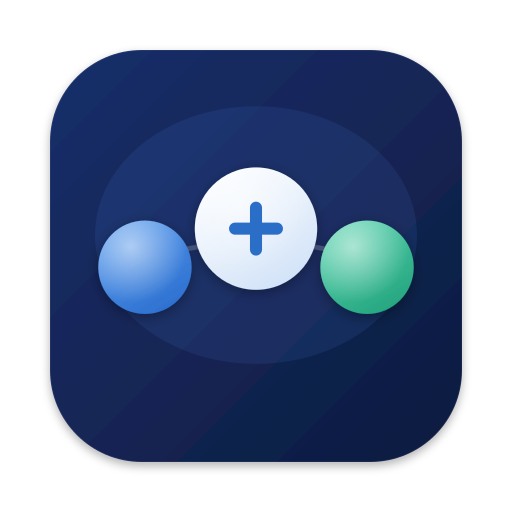
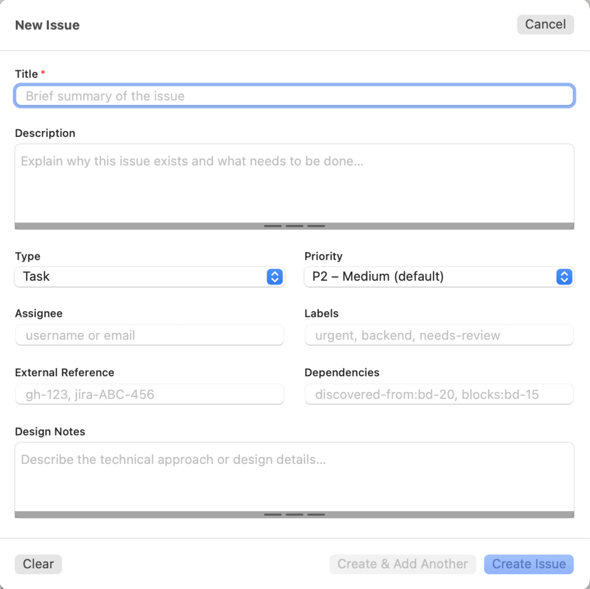
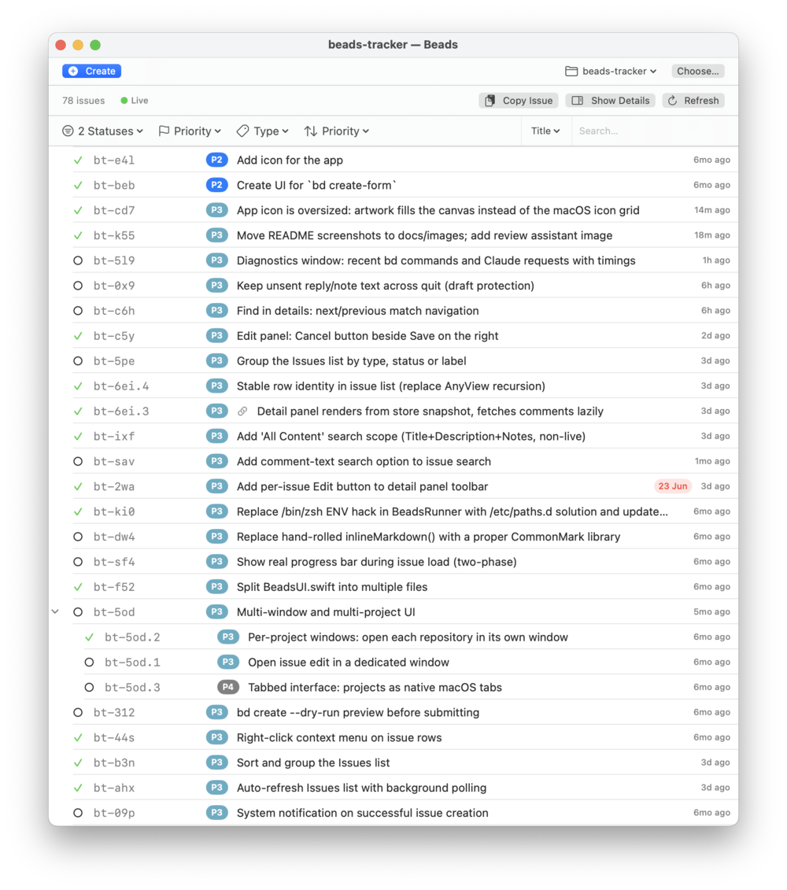
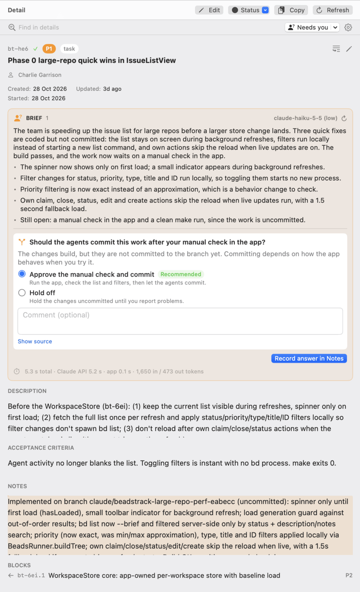

# Beads Tracker

A native macOS app for creating, browsing and managing issues in the [beads](https://github.com/gastownhall/beads/) (`bd`) issue tracking system — no CLI required. It stays fast and live on large workspaces, with a thousand issues and many agents working at once.

**Repository:** [github.com/cngarrison/beads-tracker](https://github.com/cngarrison/beads-tracker) · **Author:** [@cngarrison](https://github.com/cngarrison)



---

## Screenshots

<table>
  <tr>
    <td align="center"><strong>Create an issue</strong></td>
    <td align="center"><strong>Browse issues</strong></td>
    <td align="center"><strong>Review an issue</strong></td>
  </tr>
  <tr>
    <td valign="top"></td>
    <td valign="top"></td>
    <td valign="top"></td>
  </tr>
</table>

---

## What it does

`bd` is a powerful local-first issue tracker, but its interface is the terminal. Beads Tracker gives it a native SwiftUI window:

- **Fast on large workspaces.** Each workspace is read once into memory and then kept up to date, so filtering, searching and sorting are instant, with no `bd` call per keystroke. Lists of a thousand issues stay responsive while agents create and update issues around you.
- **Live.** Changes from anyone, including your agents, appear as they happen, using `bd`'s events journal (the **Live** indicator). The list is also re-read in the background every few minutes, to pick up changes the journal doesn't record such as `bd dolt pull`, and it stays on screen while it refreshes.
- **Browse the whole tree.** Epics expand to show their children. Filter by status, priority and type; sort by priority, last modified (an epic rises when its visible children change) or created date; search by title, description, notes, all three, or ID.
- **See and act on issues.** Select one or many (click, ⌘-click, Shift-click) to see them in the detail panel, with description, design, acceptance criteria, notes, comments, dependencies and children. Claim, close or change status, edit fields, due and defer dates, add comments, or copy issues as Markdown.
- **Review dense issues.** Agent-written issues can be hard to read. Find a word across the content of the issues you're viewing, or turn on **Needs you** to pull out the questions and decisions waiting on you. With your Anthropic API key, Claude rewrites an issue as a plain-language brief, with each decision as a question you answer by picking an option. Your answers and notes go into the issue's Notes, signed and dated, with no edit form.
- **Create issues** by describing them in your own words: with your Anthropic API key, Claude fills in the form (type, priority, parent, links to related or earlier issues) and flags possible duplicates, and you check it before anything is created. Or use the form directly, which mirrors `bd create-form`: title, description, type, priority, assignee, labels, external reference, parent, dependencies, design notes, acceptance criteria and notes. An unsaved form is kept as a draft, and quitting asks before discarding it.
- **Multi-window.** Open a window per project, each with its own repository, filters and selection. Windows on the same repository share one in-memory copy, and recent repositories are a click away.
- **Works with embedded or server-mode Dolt.** No special configuration: the app shells out to `bd`, so it follows whatever storage mode your project already uses.

---

## Install

Download the latest signed and notarized `.dmg` from [GitHub Releases](https://github.com/cngarrison/beads-tracker/releases), open it and drag **Beads Tracker** into **Applications**.

You need macOS 13 (Ventura) or later, [`bd`](https://steveyegge.github.io/beads/getting-started/installation) installed, and a repository that uses beads (one with a `.beads/` directory). If the app can't find `bd`, see [`bd` not found](docs/troubleshooting.md#bd-not-found).

## Documentation

The [user guide](docs/README.md) covers:

- [Getting started](docs/getting-started.md): opening a repository, windows and live updates
- [Browsing and filtering](docs/browsing.md): the issue list, search and the detail panel
- [Creating and editing issues](docs/creating-and-editing.md)
- [Reviewing issues](docs/reviewing.md): Find in details, Needs you, the Claude brief and replies in Notes
- [Troubleshooting](docs/troubleshooting.md): `bd` not found, live updates and the log file

---

## Build from source

You need the Xcode Command Line Tools (`xcode-select --install`).

```bash
git clone https://github.com/cngarrison/beads-tracker.git
cd beads-tracker

make          # compiles the .swift files → BeadsTracker.app
make run      # compiles + opens the app
make clean    # removes BeadsTracker.app
```

The `Makefile` builds for your Mac's architecture (Apple Silicon or Intel). There is no Xcode project and there are no third-party dependencies: `swiftc` compiles the source files straight into an `.app` bundle, which keeps the project small enough for a new contributor, or an AI coding agent, to read in one pass.

To rebuild the icon from `BeadsTracker.svg`, install `librsvg` (`brew install librsvg`) and run `make icon`, then `make`.

## Contributing

See [CONTRIBUTING.md](CONTRIBUTING.md) for the project layout, conventions and release process, [ROADMAP.md](ROADMAP.md) for what's planned, and [dev-docs/](dev-docs/) for developer notes. You don't need to know Swift: the app was first written in about 30 minutes by a non-Swift developer working with Claude, as described in [How Beads Tracker was built](dev-docs/how-it-was-built.md).

## License

MIT
