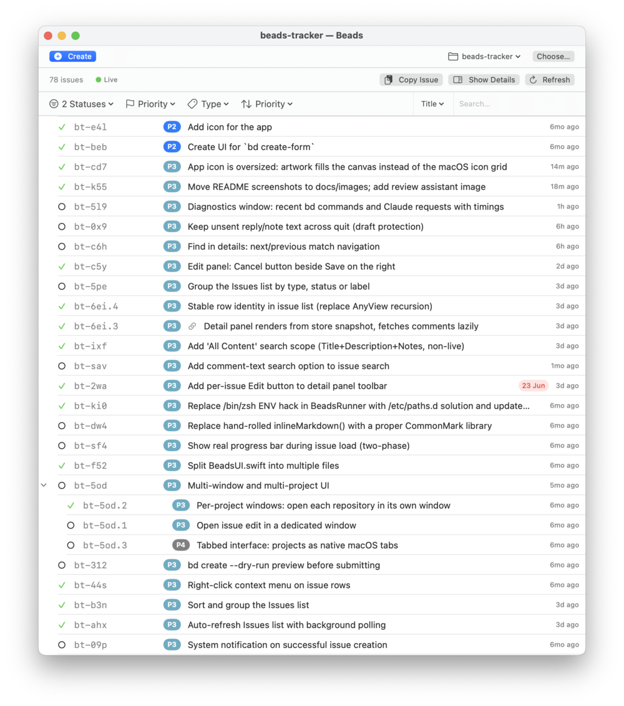

# Browsing and filtering

[User guide](README.md) › Browsing and filtering

The list shows every issue in the repository. Epics expand to show their children, and the
list stays fast with a thousand issues because filtering, searching and sorting happen in
memory, without running `bd` each time.

## Filter and sort

The menus above the list filter by **status**, **priority** and **type**. The sort menu orders
the list by:

- **Priority**: highest first, then newest created (the order `bd list` uses)
- **Last Modified**: most recently changed first. An epic counts the changes to its visible
  children, so it rises when work happens under it.
- **Created**: newest first

Children are sorted the same way within their parent.

## Search

Click the search field or press `⌘F`. The menu beside it picks what to search:

- **Title**, **Description** or **Notes**, or **All Content** for all three. Matching is
  case-insensitive, and the filters still apply.
- **ID**: type one or more IDs separated by spaces or commas. Matching issues are shown
  whatever their status, priority or type; the filter menus dim while they are ignored.

## Select issues

Click a row to show the issue in the detail panel. `⌘`-click, `Shift`-click or drag to select
several; the panel then shows a card for each. **Hide Details** / **Show Details** in the
toolbar hides or shows the panel, and you can drag the divider to resize it.

Each card shows the issue's description, design, acceptance criteria, notes, comments,
dependencies, children and dates. On a card:

- the ID button copies the ID
- the pencil edits the issue (so does double-clicking its row); see
  [Editing an issue](creating-and-editing.md#editing-an-issue)
- the note button adds a signed, dated line to Notes; see
  [Reviewing issues](reviewing.md#reply-in-notes)
- the wand button describes changes in your own words for Claude to propose; see
  [Describing changes](creating-and-editing.md#describing-changes-in-your-own-words)

With one issue selected, the panel's toolbar also has **Edit**, a **Status** menu (Open, In
Progress, Blocked, Deferred, Closed), **Copy** (the issue as Markdown) and **Refresh**.

The bar above the cards holds **Find in details** and **Needs you**, described in
[Reviewing issues](reviewing.md).

## Right-click a row

The row's menu has **Edit…**, **View Detail** (the full issue in its own sheet), **Copy ID**,
**Copy Title**, **Copy Details as Markdown**, and **Claim** or **Close** when they apply.

## Copy several issues

**Copy Issue** / **Copy Issues** in the list's toolbar copies the selected issues as Markdown,
for pasting into a chat, a document or an agent's prompt.

## Next

- [Creating and editing issues](creating-and-editing.md)
- [Reviewing issues](reviewing.md)
