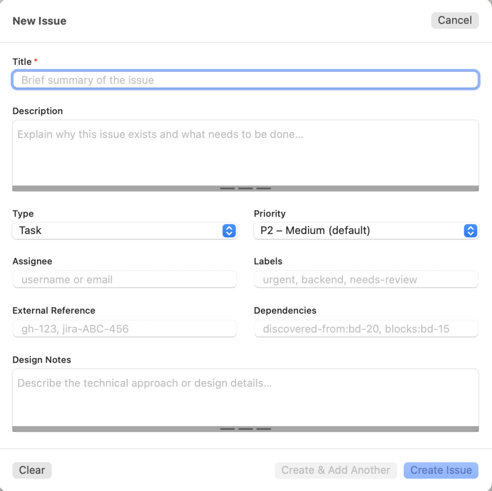

# Creating and editing issues

[User guide](README.md) › Creating and editing issues

## Creating an issue

Click **Create** at the left of the top bar. Fill in at least the **Title** (marked `*`), then
click **Create Issue** or press `⌘↵`. **Create & Add Another** creates the issue and keeps the
form open for the next one; **Clear** empties the form.

A green banner shows the new issue's ID, with **Copy ID** to put it on the clipboard.

The form mirrors `bd create-form`:

| Field | `bd create` flag | Notes |
|---|---|---|
| Title | `--title` | Required |
| Description | `--description` | Multi-line |
| Type | `--type` | task, bug, feature, epic or chore |
| Priority | `--priority` | P0 (critical) to P4 (backlog); P2 by default |
| Assignee | `--assignee` | Username or email |
| Labels | `--labels` | Comma-separated |
| External Reference | `--external-ref` | e.g. `gh-123` |
| Dependencies | `--deps` | e.g. `blocks:bd-15` |
| Design Notes | `--design` | Multi-line |
| Acceptance Criteria | `--acceptance` | Multi-line |

### Drafts

If you quit while the create form has unsaved content, Beads Tracker asks first: **Save Draft
& Quit** keeps what you typed, **Discard & Quit** throws it away, and **Cancel** keeps the app
open. Next time you open the form, a banner offers to **Resume** the draft or **Discard** it.

## Editing an issue

Open the edit sheet with the pencil on a detail card, **Edit** in the detail panel's toolbar,
**Edit…** in a row's right-click menu, or by double-clicking a row. Change any of the fields
above, then click **Save** (`⌘↵`); **Cancel** (`Esc`) leaves the issue as it was.

The sheet also has:

- **Dates**: set or clear the **Due** and **Defer** dates.
- **Dependencies**: add one by typing an issue ID and picking its type (blocks, tracks,
  related, parent-child or discovered-from), or remove one with its button. These are applied
  straight away.
- **Notes**: saved with the other fields when you click **Save**. To add a signed, dated line
  without opening the sheet, use the note button on a card instead (see
  [Reply in Notes](reviewing.md#reply-in-notes)).
- **Comments**: type a comment and click **Add**. If you click **Save** with a comment typed but
  not added, the app asks whether to add it or discard it.

## Changing status

With one issue selected, the **Status** menu in the detail panel's toolbar sets it to Open, In
Progress, Blocked, Deferred or Closed. A row's right-click menu also has **Claim** (assign it
to you and mark it in progress, as `bd update --claim` does) and **Close**.

## Next

- [Reviewing issues](reviewing.md)
