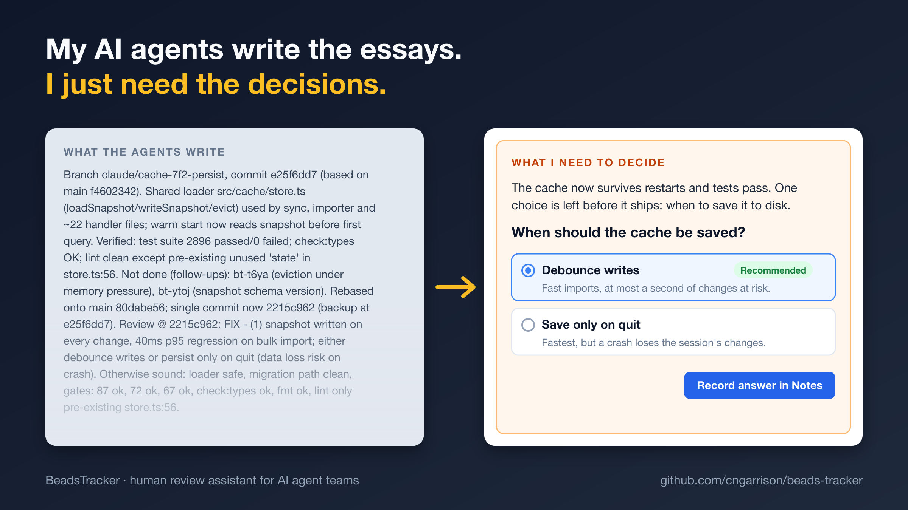

# Reviewing issues

[User guide](README.md) › Reviewing issues

Issues written by agents can be long and dense, with the questions meant for you buried in the
notes. The bar above the detail cards helps you get through them.



## Find in details

**Find in details** (`⌥⌘F`) highlights a word in every section and comment of the issues shown
in the detail panel, and counts the matches. (`⌘F` stays the list's search.)

## Needs you

**Needs you** adds a box to the top of each card listing the questions and decisions waiting on
you, and highlights where they appear in the text. Click it to turn it on for the issues shown;
choose **Always Show** from its menu to turn it on for every issue (remembered across
relaunches).

By default the items are found with **built-in rules**, with no network: they look for question
sentences and phrases such as "decide whether", "decision needed" or "for CNG". For a clearer
picture, switch to Claude (see [Settings](#settings)) and get a brief instead.

## Reply in Notes

**Reply** to an item, or use the note button beside the pencil on a card, to add a line to the
issue's Notes (`bd update --append-notes`), signed with your initials and dated. Type your
answer and click **Add to Notes** (`⌘↵`):

```
CNG 2026-11-01 (re: (3) "Which option should we take?"): Option B. Keep it simple for now.
```

When the question is numbered or lettered in the issue (`(3)`, `2.`, `b)`, `Q4`), the reply
keeps that label, so your agents can tell which question it answers. Items that already have a
reply like this are marked ✓.

Replies only ever add to Notes; nothing else in the issue changes, and you don't need to open
the edit sheet.

## The Claude brief

With Claude chosen in the settings, the Needs you box becomes a **Brief**:

- A short summary of what the issue is about and where it stands, with the key points.
- Each item waiting on you as a plain question with its background and the options to choose
  from, the recommended one marked. **Show source** shows the original text.
- Pick options and add comments on as many items as you like, then click **Record answers in
  Notes** to add them all in one update. The brief is then remade from the new Notes, so the
  items you answered drop out.
- Items Claude considers already answered are listed under **Answered**, with the line it took
  as your answer, so you can see why something isn't waiting on you.

A brief is made once per issue. If the issue changes some other way, the brief says it is out
of date; click ↺ or **Refresh** to make a new one.

Two things help when a brief surprises you:

- **Request & response** shows the brief's saved request and Claude's raw answer in the Finder
  (a JSON file in `~/Library/Logs/BeadsTracker/briefs/`).
- A stopwatch line under the brief shows how long it took; hover over it to see where the time
  went (connecting, waiting for Claude, the app) and how many tokens were used.

Using Claude sends the issue's content to the Anthropic API, and is billed to your API key.

## Settings

The gear on the review bar holds the review settings:

- **Sign replies as**: your initials. By default, the initials of your macOS account name.
- **Find questions and decisions with**: the **built-in rules** or **Claude**.
- **Anthropic API key**: needed for Claude, here, in the create sheet's **Describe** mode and
  in **Describe changes** on a card (see
  [Creating and editing issues](creating-and-editing.md#describing-an-issue-in-your-own-words)).
  It is kept in your Keychain; **Remove** deletes it. Model, Effort and Output limit apply to
  both.
- **Model**: Claude Haiku (`claude-haiku-5-5`) by default. The menu lists the models your key
  can use, so a newer model needs no app update.
- **Effort**: how much Claude thinks before writing; `low` by default. Lower is faster and
  cheaper; higher may judge tangled issues better.
- **Output limit**: the most Claude may write for one brief, its thinking included (32K tokens
  by default, up to 128K). A brief on an issue with many decisions can need more; if one is cut
  off, raise the limit or lower the effort. You pay only for what is written.

## See also

- [How the Claude brief works](../dev-docs/claude-brief.md), for developers
